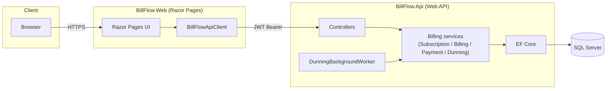

# BillFlow

[](https://github.com/edu-tech220/billflow/actions/workflows/ci.yml)


Subscription billing & invoicing platform built as two ASP.NET Core 8 microservices: a
Web API that owns every billing rule, and a Razor Pages frontend for customers and admins.

## What it solves

BillFlow runs the back office of a SaaS product: customers subscribe to a plan, get billed
every period, can upgrade or downgrade mid-cycle, and pay their invoices — with the
boring-but-critical parts (proration math, invoice numbering, failed-payment retries,
double-charge prevention) handled correctly under concurrency instead of hand-waved away.

## Business rules

- **Subscription lifecycle is a state machine.** `Trialing → Active → PastDue → Canceled /
  Expired`, enforced centrally (`SubscriptionTransitions`) so no code path can push a
  subscription into an illegal state. Reactivating a canceled subscription means creating a
  new one — history is never rewritten.
- **Mid-cycle plan changes are prorated.** Switching plans credits the unused time on the old
  plan and charges for the remaining time on the new one, both scaled by the fraction of the
  billing period left (`ProrationCalculator`). A net charge produces an immediately-due
  invoice; a net credit is banked on the customer and applied to their next renewal.
- **Invoice numbers are sequential and human-readable** (`INV-2026-000001`), minted from a
  per-year counter row. Concurrent requests racing for the same number retry on conflict
  instead of colliding — the same code path works on SQL Server and SQLite.
- **Payments are idempotent.** Charging an invoice takes a client-supplied idempotency key;
  replaying the same key — after a timeout, a retry, or a double-click — never charges twice,
  even if two requests race for the same key (a unique-index violation is caught and resolved
  by returning the first attempt's result).
- **Failed payments trigger dunning.** A decline schedules a retry at +1, +3 and +7 days and
  moves the subscription to `PastDue`; after the third failed attempt the invoice is written
  off as `Uncollectible` and the subscription is canceled. A background worker sweeps for due
  renewals and due retries every few minutes; admins can also trigger the same sweep by hand.

## Architecture



Two independently deployable services, each with its own Dockerfile:

- **BillFlow.Api** — the only thing that talks to the database. Owns every business rule,
  issues JWTs, and runs the dunning worker in-process.
- **BillFlow.Web** — a Razor Pages app with no database access at all. It calls the API over
  HTTP via a typed `HttpClient` (`IHttpClientFactory`) and forwards the JWT it got at login
  from its own auth cookie.

## Technical decisions

- **Portable optimistic concurrency.** Instead of SQL Server's native `rowversion`, every
  mutable entity carries a plain `Guid ConcurrencyStamp` configured as an EF Core concurrency
  token. It's refreshed on every update in `DbContext.SaveChangesAsync`, so the exact same
  model and the exact same conflict behavior work against SQLite in tests and SQL Server in
  production — no `#if` branching, no "works on my database" surprises.
- **Idempotency via a unique index, not just an in-memory check.** The idempotency-key lookup
  happens before charging, but the real guarantee is a unique database constraint: if two
  requests still race past the lookup, the loser's `SaveChanges` throws, and the code catches
  that and returns the winner's result instead of erroring out.
- **PBKDF2 + JWT, no ASP.NET Core Identity.** Password hashing (PBKDF2-HMAC-SHA256, random
  salt per user) and JWT issuance are both small, explicit, auditable classes — appropriate
  for a service that only needs two roles and doesn't want Identity's schema and surface
  area.
- **The dunning sweep is one service, two callers.** `IDunningSweeper` is called by both the
  recurring `BackgroundService` and the admin "run now" endpoint, so there's exactly one
  implementation of "what counts as due" to keep correct.
- **SQLite in tests, SQL Server in production.** The full test suite — including the
  `WebApplicationFactory` HTTP tests — runs against an in-memory SQLite database with no
  Docker, no external service, and no network call. This caught a real bug during
  development: SQLite can't translate `ORDER BY` on a `decimal` column, which only surfaced
  once the plans endpoint was tested over real HTTP instead of mocked.

## Endpoints

| Method | Route | Auth | Description |
|---|---|---|---|
| POST | `/api/auth/register` | Anonymous | Create a customer account, returns a JWT |
| POST | `/api/auth/login` | Anonymous | Exchange credentials for a JWT |
| GET | `/api/plans` | Anonymous | Active plan catalog (admins also see inactive plans) |
| POST | `/api/plans` | Admin | Create a plan |
| PUT | `/api/plans/{id}` | Admin | Update a plan's price, name or active flag |
| POST | `/api/subscriptions` | Customer | Subscribe the current customer to a plan |
| GET | `/api/subscriptions/me` | Customer | The current customer's latest subscription |
| POST | `/api/subscriptions/me/change-plan` | Customer | Prorated plan change |
| POST | `/api/subscriptions/me/cancel` | Customer | Cancel now or at period end |
| GET | `/api/invoices` | Customer/Admin | Paginated invoices (own only, or filter by `customerId` as Admin) |
| GET | `/api/invoices/{id}` | Customer/Admin | A single invoice (403 if it isn't yours) |
| POST | `/api/invoices/{id}/payments` | Customer/Admin | Charge an invoice; requires an `Idempotency-Key` header |
| GET | `/api/customers` | Admin | Paginated customer list |
| POST | `/api/admin/dunning/run` | Admin | Manually run the renewal/dunning sweep |

## Running it

### Docker Compose (API + Web + SQL Server)

```bash
docker compose up --build
```

- Web UI: http://localhost:5082
- API + Swagger: http://localhost:5048/swagger

### Locally with `dotnet run`

Requires a SQL Server instance reachable at the connection string in
`src/BillFlow.Api/appsettings.json` (defaults to `localhost,1433` — see
`docker-compose.yml` for a one-line `docker compose up sqlserver` if you just want the
database).

```bash
dotnet run --project src/BillFlow.Api
dotnet run --project src/BillFlow.Web
```

The web project's `Api:BaseUrl` already points at the API's `http://localhost:5048` from
`launchSettings.json`, so both run with zero extra configuration.

### Demo admin account

Seeded automatically on first run:

- Email: `admin@billflow.dev`
- Password: `Admin#12345`

## Testing

```bash
dotnet test
```

54 tests covering:

- Pure business rules (proration math, state machine transitions, dunning backoff schedule)
- Service-level behavior against SQLite (subscription lifecycle, payment idempotency, the
  full decline → retry → write-off dunning sequence)
- The dunning background worker's ticking and failure isolation
- The full HTTP pipeline via `WebApplicationFactory` (auth, authorization, pagination,
  cross-customer data isolation, ProblemDetails error responses) — still against SQLite, no
  external services required

No SQL Server, Docker, or network access needed to run the suite.
